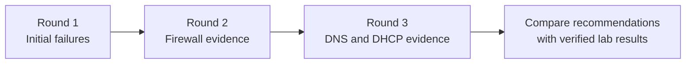

# AI Usage and Critique

**Group:** Penguins
**Members:** Preston Shah Aman, Ye Myat Aung, Pyae Phyo Paing, Sai Soom Rath, Hashir Khan
**Company / Domain:** NovaPeak / `novapeak.lab`

## Part 3a: Declaration (required)

| AI tool | What we used it for |
|---|---|
| ChatGPT (OpenAI) | Assisted with troubleshooting reasoning, command planning, interpreting terminal results, Git workflow, and report preparation during the original investigation. Later tested as AI #1 in the comparison. |
| Claude (Anthropic) | Used as AI #2 to review the completed incident through the same staged diagnostic questions given to ChatGPT. |

These were the only two AI tools used in this project.

We did not treat an AI recommendation as proof of a fault. Our technical conclusions were checked through actual configuration inspection, terminal commands, client-side DNS tests, and official checker results.

## Part 3b: Confirm you diagnosed first

We completed the live investigation and verified four faults before conducting the structured comparison between ChatGPT and Claude.

However, ChatGPT assisted with reasoning and command planning during our original troubleshooting. We therefore cannot claim that the investigation was entirely AI-independent. The distinction is that we verified each diagnosis through the system's actual behavior rather than accepting an AI explanation without testing it.

The four faults established during our investigation were:

1. **Incorrect forward-zone reference:** BIND referenced `/etc/bind/db.MISSING` instead of the existing `db.novapeak.lab` file.
2. **Firewall blocking DNS:** An iptables INPUT rule dropped UDP packets destined for port 53.
3. **Incorrect API record:** `api.novapeak.lab` returned `192.168.19.1` instead of `192.168.19.40`.
4. **Incorrect DHCP resolver:** DHCP advertised `8.8.8.8` instead of the internal DNS server `192.168.19.10`.

The checker results progressed through:

**11.0 → 12.0 → 18.25 → 19.0 → 25.0 / 25**

We tested the system again after each correction. This helped us distinguish an actual cause from other failures that depended on it.

## Part 3c: Putting the AIs to the test

### Comparison Workflow



### How we conducted the comparison

We tested ChatGPT and Claude separately, giving both the same questions and evidence in three rounds.

- **Round 1:** Initial checker result (11/25) and the missing BIND forward-zone file.
- **Round 2:** BIND listening settings, a client DNS timeout, and firewall packet counters increasing after a failed query.
- **Round 3:** The incorrect API record, DHCP configuration, expected addresses, and remaining checker failures.

We provided the evidence gradually to see whether each AI could separate confirmed findings from possible causes.

This comparison was evidence-guided, not completely blind. In Round 3, we explicitly provided the required API address and internal DNS server. Correct answers in that round show that the models could interpret the configuration errors and recommend repairs; they do not prove that either model could have discovered those requirements independently.

### Comparison Results

| Fault (in our words) | We found it? | AI #1 — ChatGPT | AI #2 — Claude | Was each AI actually right? |
|---|---|---|---|---|
| **1. Wrong forward-zone file reference** | Yes, through system inspection and validation. | Identified the missing file and recommended checking the real zone path. | Identified the same problem and recommended correcting the path. | **Both correct.** After correction, `named-checkconf -z` loaded the zone and C4 passed. Score: **11 → 12**. |
| **2. Firewall blocked UDP/53** | Yes, through packet counters and client-side testing. | Correctly identified the firewall, but proposed inserting a restricted ACCEPT rule before the DROP rule. | Correctly identified the firewall and proposed removing the specific DROP rule. | **Both diagnoses correct.** Claude's proposed repair matched our tested correction. ChatGPT's alternative remained untested. Score: **12 → 18.25**. |
| **3. API A record contained the wrong address** | Yes, by comparing the DNS response with the required address. | Recommended correcting the A record and increasing the SOA serial. | Recommended the same changes. | **Both correct.** Zone validation passed, and the client received `192.168.19.40`. Score: **18.25 → 19**. |
| **4. DHCP advertised the wrong resolver** | Yes, through configuration inspection and integration checks. | Recommended changing DHCP Option 6 to `192.168.19.10`. | Recommended correcting the same subnet-level option. | **Both correct.** C9 and C11 passed after the repair. Score: **19 → 25**. |

### Our Critical Evaluation

#### 1. Correcting the DNS zone did not restore client connectivity

Both AI tools correctly identified the missing forward-zone reference in Round 1.

However, we could not conclude that every failed DNS lookup was caused by the missing zone. If a client cannot reach the DNS server, it will fail to retrieve records even when the records are correct.

We confirmed this during the live investigation. After correcting `db.MISSING`, BIND successfully loaded the forward zone, but the client still timed out. The checker increased only from **11 to 12/25**.

This meant the zone-loading error was fixed, but another problem remained.

**Our judgment:** Both models correctly diagnosed the configuration error. The important part was verifying what the correction actually resolved. A valid BIND configuration does not automatically mean clients can access the service.

#### 2. Firewall diagnosis — both correct, but different repairs

In Round 2, both models identified the firewall DROP rule as the strongest explanation for the remaining client timeout.

Our evidence showed:

- BIND was active and listening on `192.168.19.10:53`.
- `allow-query { any; };` permitted incoming queries.
- The client still experienced a DNS timeout.
- The UDP/53 DROP counter increased from **6 packets / 517 bytes** to **7 packets / 602 bytes** after the failed query.

The counter increase showed that the rule was actively matching and dropping traffic. However, the counter alone could not prove the identity of the dropped packet. We needed a correction followed by a client-side test to establish the cause more convincingly.

**Claude recommended** removing the specific DROP rule:

```bash
iptables -D INPUT -p udp --dport 53 -j DROP
```

**ChatGPT recommended** inserting a restricted ACCEPT rule before the existing DROP rule.

We do not consider ChatGPT's suggestion automatically wrong. In a production network with a restrictive access policy, allowing only approved clients could be appropriate. However, its approach would leave the original DROP rule in place, and the exception would have to cover every intended client.

ChatGPT also used `192.168.19.20` as an example client source address, while warning that it needed verification. In our configuration, this address belonged to the `www` host. The checker reported a client lease of `192.168.19.104`. Applying that example without checking the actual client address could leave the client blocked.

Our earlier Killercoda repair matched the approach Claude later recommended. After backing up the firewall rules, we removed the specific DROP rule. The client then received an authoritative `NOERROR` response for `www.novapeak.lab`, returning `192.168.19.20`. The checker increased from **12 to 18.25/25**.

Claude did not guide this original correction; the AI comparison happened afterward.

**Our judgment:** Both identified the correct root cause. Claude's repair matched what we successfully tested in this lab. ChatGPT's alternative was technically plausible but untested, so we cannot claim that it would have failed.

The difference matters because identifying the cause and choosing the most suitable correction are two separate parts of troubleshooting.

#### 3. A successful DNS response did not mean the record was correct

In Round 3, both models identified the incorrect API A record.

The DNS server returned:

```text
api.novapeak.lab. 3600 IN A 192.168.19.1
```

But the assignment required:

```text
api.novapeak.lab. 3600 IN A 192.168.19.40
```

The original query returned `NOERROR`, but the address was still incorrect.

`NOERROR` indicates that the query was processed without a DNS error. It does not guarantee that the returned value matches the system's requirements.

Both models recommended correcting the record and increasing the SOA serial. They suggested `2024010102`, which would be a valid serial increase. Our actual repair used `2026101001`, reflecting the repair date. That difference does not make either AI recommendation incorrect.

After our correction, `named-checkzone` reported `OK`, BIND restarted successfully, and the client query returned `192.168.19.40`. The checker increased to **19/25**.

**Our judgment:** Both recommendations were correct. We verified the repair by checking the returned address, not merely the DNS response status.

This also demonstrated that DNS connectivity and DNS data accuracy must be tested separately.

#### 4. DHCP configuration and client resolver behavior required different checks

Both models correctly identified the DHCP fault:

```text
option domain-name-servers 8.8.8.8;
```

The required setting was:

```text
option domain-name-servers 192.168.19.10;
```

Both recommended correcting that option while preserving the working subnet, address pool, gateway, and domain settings.

The main difference was how they suggested verifying the repair.

ChatGPT expected `/etc/resolv.conf` to show the internal DNS server after the DHCP lease was renewed. Claude was more cautious and explained that the client's visible resolver configuration might not directly reflect the DHCP-provided DNS setting.

Our Killercoda environment supported Claude's caution. The client namespace's `/etc/resolv.conf` did not reliably show the DNS address advertised through DHCP.

We also could not rely only on a command such as:

```bash
dig @192.168.19.10 www.novapeak.lab
```

This explicitly queries the internal DNS server. It can verify that BIND responds, but it bypasses the client's normal resolver selection and does not prove that DHCP supplied the correct resolver.

Instead, we verified the two relevant conditions separately:

- **C9:** DHCP advertised `192.168.19.10`.
- **C11:** The client successfully resolved `www.novapeak.lab` through its leased resolver.

Both passed after we corrected DHCP Option 6 and restarted the service. The checker reached **25/25**.

**Our judgment:** Both identified the correct fault. Claude's verification advice was slightly more suitable for our environment because it recognized that `/etc/resolv.conf` might not represent the DHCP lease. ChatGPT's suggested inspection was useful, but insufficient as final evidence by itself.

#### 5. We did not treat every failed check as another fault

Both models considered alternative explanations during the investigation.

In Round 1, Claude suggested that the reverse lookup failure might involve PTR records pointing into the unloaded forward zone. This was only a hypothesis. A direct PTR lookup does not normally depend on the corresponding forward zone being loaded.

Our reverse zone loaded successfully from the beginning. After the firewall correction, the reverse lookup check passed without any modification to the reverse-zone file.

This showed that the reverse lookup failure was caused by the client's inability to reach DNS, rather than a separate confirmed PTR-record problem.

Similarly, both models mentioned possible concerns such as firewall persistence and recursion settings. These may matter in other environments, but our evidence did not establish them as additional faults in this lab.

**Our judgment:** Possible causes were worth considering, but we did not change configurations without evidence. The investigation identified four faults, even though more than four checker conditions initially failed.

### Overall Comparison

| Evaluation area | ChatGPT | Claude | Our judgment |
|---|---|---|---|
| Initial diagnosis | Correct | Correct | Tie |
| Firewall root-cause identification | Correct | Correct | Tie |
| Firewall repair for this lab | Plausible but untested | Matched our tested repair | Claude advantage |
| API record correction | Correct | Correct | Tie |
| DHCP correction | Correct | Correct | Tie |
| Client resolver verification | Less cautious about `/etc/resolv.conf` | Better qualified its limitations | Claude slight advantage |

Both tools performed well when given sufficient evidence.

Claude had a modest advantage in recommending the firewall correction that matched our tested repair and in handling uncertainty about the client's resolver configuration.

However, this does not mean Claude is generally more accurate than ChatGPT. Our conclusion applies only to this incident and the evidence supplied during the comparison.

## Part 3d: Verdict

**Where our human diagnosis beat the AIs**

The advantage of working directly with the system was that we could test whether each explanation was actually correct. For example, fixing the forward-zone reference did not resolve the client timeout, while removing the firewall DROP rule did. This allowed us to distinguish separate causes from related symptoms. Although ChatGPT assisted our original troubleshooting, the final findings were established through the system behavior and tests we observed.

**Where AI genuinely helped**

ChatGPT helped us organize the troubleshooting process, interpret command output, and plan verification steps. During the later comparison, both tools correctly identified the major configuration errors. Claude's firewall recommendation matched our successful repair, while ChatGPT raised a reasonable security consideration about restricting DNS access to approved clients. These suggestions were useful because we could assess them against actual evidence rather than accept them automatically.

**What we learned about trusting AI**

Both models could reason from the information we provided, but neither could inspect the live environment during the comparison. Some recommendations were directly supported by our tests, while others remained plausible but unverified. We learned to separate a possible cause from a confirmed one, make only the changes supported by evidence, and verify the result from the client's perspective.

The final **25/25** checker result confirmed that our repaired configuration met the lab's requirements. It did not mean every suggestion from either AI was necessary, correct for every environment, or independently tested.
