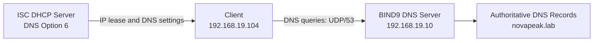
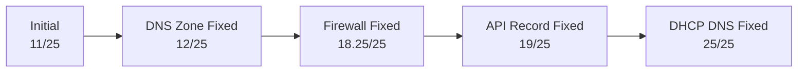

# Server OS Midterm — Penguins

**Course:** 192-442 Server Operating System  
**Assignment:** DNS & DHCP Incident Investigation and Recovery

## Group Information

- **Group Name:** Penguins
- **Company:** NovaPeak
- **Assigned Domain:** `novapeak.lab`
- **Checker Group ID:** `lab01`

## Group Members

| Name | Student ID | GitHub Username |
|---|---|---|
| Preston Shah Aman | 6705142025 | [@preston-shah](https://github.com/preston-shah) |
| Ye Myat Aung | 6705142009 | [@bruh65251-cloud](https://github.com/bruh65251-cloud) |
| Pyae Phyo Paing | 6705142024 | [@Percy022](https://github.com/Percy022) |
| Sai Soom Rath | 6705142034 | [@SaiSoomRath](https://github.com/SaiSoomRath) |
| Hashir Khan | 6705142019 | [@hashirkhnn](https://github.com/hashirkhnn) |

## Project Overview

This project investigates and repairs DNS and DHCP failures in a simulated company network. The objective is to restore reliable internal hostname resolution for clients joining the network through automatic configuration.

The investigation follows an evidence-based process: observe failures, identify causes, apply corrective actions, and verify recovery from the client's perspective.

### Network Architecture

The DHCP server provides the client with its network configuration, including the internal DNS server address. The client then queries BIND9 to resolve company hostnames within `novapeak.lab`.

## Technical Recovery Summary

- **Environment:** NovaPeak internal DNS and DHCP services
- **Initial checker result:** 11.0/25
- **Final checker result:** 25.0/25

The investigation identified and corrected four faults affecting service configuration, network accessibility, DNS record accuracy, and DHCP–DNS integration.

1. **DNS zone loading:** An invalid file reference in `named.conf.local` prevented BIND from loading the authoritative forward zone.
2. **Network access:** An inbound firewall rule dropped UDP traffic destined for port 53, preventing clients from reaching the DNS service.
3. **DNS record accuracy:** The authoritative A record for `api.novapeak.lab` contained an incorrect IPv4 address, which was corrected to `192.168.19.40`.
4. **DHCP–DNS integration:** DHCP Option 6 advertised `8.8.8.8` instead of the internal DNS server `192.168.19.10`.

Corrections were verified through configuration validation, service checks, client-side DNS queries, and repeated execution of the official checker.

### Verified Recovery Progression

All 11 official checks passed in the final verification.

Detailed diagnostic evidence, technical reasoning, corrective actions, and confirmation results are documented in `INCIDENT_LOG.md` and the original terminal recording.

## Submission Contents

- `fixed-configs/` — Six collected DNS and DHCP configuration files.
- `INCIDENT_LOG.md` — Evidence-based fault investigation, diagnosis, corrections, and verification.
- `AI_CRITIQUE.md` — AI assistance declaration, comparison, and critical evaluation.
- `session.log` — Original recorded terminal investigation.
- `checker_result.txt` — Final official checker result (25.0/25).

The submitted configuration files and verification evidence originate from the completed Killercoda environment.
